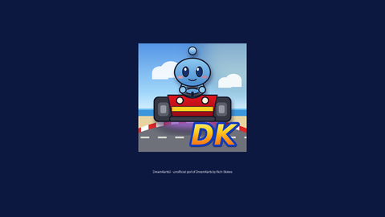

# Wii U Homebrew

Homebrew for the Nintendo Wii U from Hiraeth Systems. Each project lives in its own repository; this page is the catalogue.

Everything here targets the Aroma environment and has been tested on real hardware.

## Games

| Preview | Project | Latest download | Status |
|---|---|---|---|
|  | **[DreamKartsU](https://github.com/hiraethsystems/DreamKartsU)** An unofficial Wii U port of [DreamKarts](https://github.com/richstokes/dreamcast-homebrew/tree/main/projects/games/dreamkarts), Rich Stokes' Dreamcast kart racer. Online races run on the same lobby server as the Dreamcast version, so Wii U players can race real Dreamcasts. | **[WUHB](https://github.com/hiraethsystems/DreamKartsU/releases/latest)** | In development, online play working |

## Installing

1. Download the `.wuhb` from the project's release page.
2. Copy it to `SD:/wiiu/apps/<ProjectName>/` on your Wii U's SD card.
3. Start it from the Wii U Menu under Aroma.

## Credits and licences

DreamKarts is by [Rich Stokes](https://github.com/richstokes/dreamcast-homebrew); DreamKartsU is a port of his game with his permission for online play. Each project has its own licence and credits. See its repository for details.
